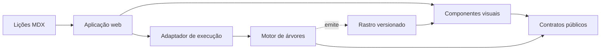

# Arquitetura

## Decisão principal

O projeto será uma aplicação estática. No MVP, o chamado “back-end” é um **motor de domínio independente da interface**, executado localmente no navegador.

GitHub Pages hospeda arquivos estáticos e não mantém um processo de servidor. Um back-end remoto aumentaria custo, operação e risco de privacidade sem ser necessário para datasets pequenos. A decisão completa está no [ADR 0001](adr/0001-static-first-browser-engine.md).

## Stack proposta

- **Astro + TypeScript:** páginas estáticas, conteúdo em Markdown/MDX e carregamento seletivo das experiências interativas.
- **React:** ilhas interativas e composição dos controles/estados do laboratório.
- **SVG:** primeira base de renderização por ser inspecionável, responsiva e acessível.
- **D3 apenas onde útil:** escalas, geometria e layouts; nunca para implementar o algoritmo de ML.
- **pnpm workspaces:** separação entre site, motor e visualizações sem múltiplos repositórios.
- **Vitest:** testes unitários e de contratos.
- **Playwright:** fluxo crítico e verificação visual/responsiva.
- **GitHub Actions:** qualidade em pull requests e deploy do artefato estático da `main`.

Astro possui suporte oficial a deploy estático no GitHub Pages por GitHub Actions. O `base` do projeto deverá ser configurado para funcionar tanto em `<usuario>.github.io/<repositorio>` quanto, no futuro, em domínio próprio.

## Regra de dependências



Regras:

- `tree-core` não conhece React, SVG, Astro, DOM ou D3;
- `tree-visuals` não recalcula impureza nem decide splits;
- `web` orquestra parâmetros, execução e reprodução;
- lições selecionam datasets, parâmetros e componentes, mas não contêm lógica de ML;
- nenhuma camada importa código da camada acima.

## Estrutura planejada do repositório

```text
tree-based-ml-lab/
├── apps/
│   └── web/
│       ├── public/                 # fontes, imagens sociais e assets estáticos
│       └── src/
│           ├── components/         # navegação e UI exclusiva do site
│           ├── content/lessons/    # conteúdo MDX e metadados pedagógicos
│           ├── layouts/
│           ├── pages/
│           └── styles/
├── packages/
│   ├── tree-core/
│   │   └── src/
│   │       ├── classification/     # treino e predição
│   │       ├── criteria/           # Gini, entropia e ganhos
│   │       ├── contracts/          # dataset, árvore, opções e rastros
│   │       ├── observers/          # captura configurável de eventos
│   │       └── testing/            # fixtures e geradores determinísticos
│   └── tree-visuals/
│       └── src/
│           ├── primitives/         # plano, pontos, nós, arestas e destaques
│           ├── scenes/             # composições pedagógicas reutilizáveis
│           ├── playback/           # etapa atual, avançar, voltar e reproduzir
│           └── themes/             # tokens visuais e acessibilidade
├── examples/                       # execuções mínimas do motor sem o site
├── docs/
│   ├── adr/                        # decisões arquiteturais
│   ├── architecture.md
│   ├── product-scope.md
│   └── roadmap.md
├── .github/workflows/              # CI e deploy
├── CONTRIBUTING.md
├── package.json
├── pnpm-workspace.yaml
└── README.md
```

`tree-visuals` começa pequeno. Só um padrão usado por duas cenas deve virar primitiva pública; isso evita criar uma “biblioteca universal” antes de conhecer as necessidades reais.

## Modelo do domínio

### Dataset

O núcleo recebe apenas números e metadados, nunca objetos de interface:

```ts
interface Dataset {
  features: number[][];
  targets: Array<string | number>;
  featureNames: string[];
}
```

No MVP serão aceitas features numéricas e classificação binária. O contrato pode representar mais classes, mas suporte multiclasse só será anunciado depois de testado.

### Árvore serializável

Cada nó terá identificador estável e será discriminado por tipo:

```ts
type TreeNode =
  | {
      kind: "split";
      id: string;
      featureIndex: number;
      threshold: number;
      impurity: number;
      sampleCount: number;
      left: TreeNode;
      right: TreeNode;
    }
  | {
      kind: "leaf";
      id: string;
      prediction: string | number;
      probabilities: number[];
      impurity: number;
      sampleCount: number;
    };
```

O desenho da árvore, a coloração do plano e `predict()` usam essa mesma estrutura.

### Rastro de treinamento

O treinamento aceitará um observador opcional. Ele transforma decisões internas em eventos JSON versionados, sem inserir comandos visuais no algoritmo.

Eventos iniciais:

- `training_started`;
- `node_started`;
- `candidate_evaluated`;
- `split_selected`;
- `leaf_created`;
- `training_completed`.

Cada evento contém `step`, `nodeId`, amostras relevantes e valores calculados suficientes para explicar a decisão. O rastro terá níveis:

- `none`: produção sem explicação detalhada;
- `summary`: somente decisões selecionadas;
- `detailed`: candidatos avaliados, limitado a datasets educacionais.

Isso evita que ensembles grandes mantenham milhões de eventos apenas para produzir uma previsão.

## Fronteira entre motor e interface

A interface não chamará diretamente a implementação concreta. Ela usará um contrato assíncrono:

```ts
interface TrainingService {
  fit(request: TrainingRequest): Promise<TrainingResult>;
}
```

No MVP, `BrowserTrainingService` chama o núcleo na mesma thread. Quando o custo crescer, um `WorkerTrainingService` manterá o mesmo contrato e moverá a execução para Web Worker sem reescrever as cenas.

## Base visual reutilizável

A primeira biblioteca não tentará reproduzir Manim. Ela terá três níveis:

1. **Primitivas:** `Point`, `Axis`, `SplitLine`, `TreeNode`, `TreeEdge`, `Label`.
2. **Cenas:** `DatasetScene`, `TreeScene`, `ImpurityScene`, `DecisionBoundaryScene`.
3. **Playback:** transforma eventos do rastro em frames navegáveis e anima transições.

Futuras miniaturas de Gradient Boosting serão uma variante compacta de `TreeScene`. A cena de resíduos será nova, mas consumirá o mesmo modelo de árvore e eventos de composição do ensemble.

## Correção e testes

O núcleo deve ser comprovado independentemente da interface:

- testes de Gini, entropia e ganho com exemplos calculados manualmente;
- invariantes: filhos particionam as amostras do pai, profundidade respeita o limite e folhas preservam contagens;
- casos extremos: classe única, features constantes, empates e dataset mínimo;
- seeds fixas e regra explícita de desempate;
- testes de regressão com árvores JSON pequenas (“golden fixtures”);
- teste de integração garantindo que cada `nodeId` referenciado no rastro existe na árvore;
- comparação contra uma biblioteca conhecida apenas nos testes de validação científica, nunca na implementação de produção;
- teste de navegador cobrindo troca de critério, reprodução e reset.

## Evolução prevista

- **Regressão:** reutiliza construção, nós e busca de split; adiciona variância/MSE e outra folha.
- **Bagging/Random Forest:** compõe árvores, amostragem e agregador; mantém cada árvore inspecionável.
- **Gradient Boosting:** adiciona função de perda, pseudo-resíduos, learning rate e eventos do ensemble.
- **XGBoost educacional:** entra somente após uma especificação própria de gradientes, Hessianas e regularização.
- **Aprendizado por reforço:** estudos de caso consomem as APIs públicas; não devem contaminar o núcleo com regras específicas do ambiente.
- **Datasets do usuário:** parsing e validação locais, limites estritos e Web Worker; nenhuma transmissão por padrão.

## Critérios para um back-end remoto futuro

Um serviço remoto só será considerado quando pelo menos uma necessidade real não puder ser atendida localmente, por exemplo:

- datasets que não cabem com segurança no navegador;
- colaboração ou persistência entre dispositivos;
- filas para experimentos longos;
- execução reproduzível que exija ambiente controlado.

Nesse momento, `TrainingService` vira a fronteira de API. O site continua sem conhecer a implementação e pode trocar o adaptador local por HTTP.

## Referências operacionais

- [GitHub Pages é uma hospedagem de sites estáticos](https://docs.github.com/en/pages/getting-started-with-github-pages/what-is-github-pages)
- [Deploy do Astro no GitHub Pages](https://docs.astro.build/en/guides/deploy/github/)
- [Workflows customizados do GitHub Pages](https://docs.github.com/en/pages/getting-started-with-github-pages/using-custom-workflows-with-github-pages)
