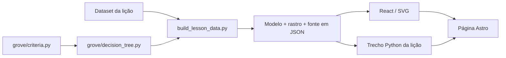

# Arquitetura

## Princípio central

Grove possui uma única implementação de machine learning: Python. A mesma
execução produz o modelo, as métricas, o rastro e o trecho de código apresentado
ao aluno. TypeScript existe somente na camada de interface e visualização.

O deploy permanece estático. Em vez de duplicar o algoritmo no navegador, o
build executa cenários didáticos determinísticos e publica os resultados como
JSON. Isso mantém o carregamento pequeno e torna impossível a visualização
divergir silenciosamente do exemplo Python.

## Camada de publicação

Os metadados editoriais vivem na coleção tipada em
`apps/web/src/content/articles/`. Ela é a fonte de identidade, locale, estado de
publicação, SEO, relações de aprendizagem e contrato pedagógico. O módulo
`apps/web/src/content/articles.ts` consulta e valida essa coleção.

Artigo, edição da newsletter, interação, projeto reproduzível e série são
entidades separadas. A decisão e as consequências estão no
[ADR 0003](adr/0003-publication-content-boundaries.md), e o fluxo completo está em
[publication-platform.md](publication-platform.md).

A primeira lição permanece em suas rotas Astro durante a migração protegida. As
novas lições usarão MDX; o campo `implementation` torna explícita essa fronteira.

As edições semanais vivem em `apps/web/src/content/issues/`. Um único MDX produz
arquivo web, HTML de e-mail, texto puro e manifesto de entrega. A API em
`apps/newsletter-api/` mantém consentimento no PostgreSQL, confirma contatos no
Resend e ingere webhooks assinados sem armazenar o e-mail na tabela analítica.
Publicar o site nunca dispara uma campanha.

`apps/observability-api/` recebe medição de leitura após opt-in e respostas
anônimas enviadas intencionalmente ao fim dos artigos. As respostas não exigem
consentimento analítico e não usam a identidade de visitante ou assinante. O serviço
compartilha o PostgreSQL do mesmo ambiente para permitir que um token temporário
de confirmação ligue o navegador consentido ao id de assinante. Staging e
produção mantêm bancos, segredos e origens separados, e não existe endpoint
público de consulta.

## Fluxo de dados



## Estrutura

```text
tree-based-ml-lab/
├── apps/web/                         # shell, páginas e conteúdo Astro
├── packages/
│   ├── tree-core/
│   │   ├── grove/
│   │   │   ├── criteria.py          # Gini, entropia e despacho
│   │   │   └── decision_tree.py     # treino, modelo e rastro
│   │   └── tests/                   # testes unitários do domínio
│   └── tree-visuals/
│       └── src/
│           ├── generated/            # saída determinística do Python
│           ├── FirstSplitExplorer.*  # protótipo preservado da primeira divisão
│           └── DecisionTreeWorkshop.*# quatro playgrounds do artigo completo
├── scripts/build_lesson_data.py      # adaptador Python → web
└── docs/adr/                         # decisões e revisões arquiteturais
```

## Regras de dependência

- `tree-core` não conhece Astro, React, SVG, DOM ou TypeScript;
- `tree-visuals` não calcula impureza, ganho ou thresholds;
- o gerador é o único adaptador entre o domínio Python e os artefatos web;
- o código exibido é extraído diretamente de `decision_tree.py` entre marcadores
  de lição, nunca copiado manualmente;
- datasets e cenários de uma lição vivem no gerador até existir repetição real
  que justifique um catálogo próprio;
- nenhuma biblioteca de ML entra no núcleo; NumPy é o limite máximo permitido.

## Contrato do artefato

Cada cenário contém uma árvore serializável, o melhor split raiz, importâncias e
um rastro ordenado de eventos por nó. Os nomes JSON permanecem estáveis para a
interface (`featureIndex`, `sampleCount`, `missingDirection`, `bestSplit`), enquanto
a API Python usa nomes idiomáticos.

O artefato também inclui o dataset, uma entrada por critério, o trecho exato de
código Python e o caminho da fonte para orientar a navegação no repositório.

## Correção e build

`pnpm test` executa os testes Python antes de qualquer teste de workspace.
`pnpm dev` e `pnpm build` regeneram os dados de lição antes de iniciar o site.
A CI configura Python e Node explicitamente, testa o núcleo, valida os tipos da
apresentação e produz o site estático.

Os testes do núcleo cobrem impureza, split perfeito, recursão, profundidade,
valores ausentes, importância, validação de entrada e serialização do rastro.
Próximas extensões devem acrescentar testes de empate determinístico, features
constantes e golden fixtures maiores.

## Evolução

Florestas e boosting comporão as árvores Python existentes sem contaminar os
modelos com comandos de renderização. Se uma experiência futura aceitar datasets arbitrários, um
executor Python (Worker ou API) consumirá o mesmo pacote `grove`; não será criada
uma segunda implementação em TypeScript.
