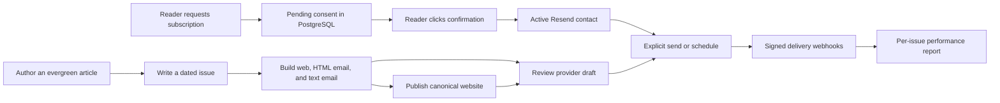

# Newsletter operations

This is the detailed operating manual for publishing Aflora. For the normal
writer-facing loop, use
[`weekly-publishing.md`](weekly-publishing.md). The website and newsletter share
content, but they are different systems with different failure modes.

## The mental model



The article is the durable lesson. The issue is a dated editorial invitation to
that lesson. Improving an article later never rewrites the email readers already
received.

## One-time Railway and Resend setup

Create one Railway project with three services:

1. a PostgreSQL service;
2. `grove-web`, using `/apps/web/railway.json` as its config file; and
3. `grove-newsletter-api`, using `/apps/newsletter-api/railway.json`.

Keep the repository root as the build context because both Dockerfiles consume
workspace files. Give both application services public domains. Deploy the API
first, then rebuild the website with its final API URL.

Set these web build variables:

- `SITE_URL`: final public website origin;
- `BASE_PATH=/`;
- `SHOW_DRAFTS=true` in staging and `false` in production;
- `PUBLIC_NEWSLETTER_API_URL`: public API origin; and
- `PUBLIC_PRIVACY_CONTACT_EMAIL`: monitored address shown in the privacy notice;
- `NEWSLETTER_POSTAL_ADDRESS`: the real mailing address displayed in every issue.

Set the API variables documented in `.env.example`. Generate `EVENT_HASH_SALT`
as a long random secret. `ALLOWED_ORIGINS` must contain exact comma-separated web
origins; wildcard CORS is rejected at startup. Point `DATABASE_URL` to the
Railway PostgreSQL service using Railway's variable reference UI.

Staging must set `NEWSLETTER_RECIPIENT_ALLOWLIST` to explicit comma-separated
test addresses. Requests for other addresses receive the same accepted response
but create no subscriber and send no email. Contact activation is checked again,
and the broadcast command refuses a Resend segment containing any address outside
the allowlist. Keep `NEWSLETTER_PUBLIC_SIGNUP=false`. Opening signups later
requires removing the allowlist and explicitly setting
`NEWSLETTER_PUBLIC_SIGNUP=true`; startup rejects missing or contradictory policy.

In Resend:

1. verify the sending domain and choose `NEWSLETTER_FROM`;
2. create an `Aflora weekly` segment and copy its id;
3. optionally create a topic when Aflora has multiple preference streams;
4. create a webhook at
   `https://<api-domain>/v1/webhooks/resend` for sent, delivered, opened,
   clicked, bounced, complained, suppressed, and contact-updated events; and
5. copy its signing secret into `RESEND_WEBHOOK_SECRET`.

On the current private GitHub Free repository, add the variables and secrets
used by `newsletter-delivery.yml` at repository level. The workflow accepts
manual dispatches only from `luccae11235`, serializes delivery runs, and still
requires the issue-scoped send confirmation. A normal push, pull request, or
Railway deploy cannot send an issue. If the repository later becomes public or
moves to a plan that supports protected private environments, move the same
configuration into a protected `newsletter-production` environment.

Before opening signups, review `/privacy` for the operator's jurisdiction and run
the retention dry run. The form remains disabled unless both the API URL and a
public privacy contact are present.

Form visibility and API audience policy are separate controls. Staging embeds
the API endpoint so allowlisted test addresses can use the form while the API
reports `audienceMode: restricted`. Pre-launch production keeps the form
disabled and the API restricted. Public launch requires both an enabled form and
`audienceMode: public`; the deployment smoke test verifies these independently.

## Proving the system works before launch

The repeatable provider-edge proof is staging-only, requires the fail-closed
recipient allowlist, and refuses non-staging Railway URLs. It sends only to
Resend's designated test recipients, waits for signed webhooks, verifies
PostgreSQL state, and removes its synthetic subscribers and contacts:

```bash
railway run --environment staging --service grove-newsletter-api -- sh -c \
  'DATABASE_URL="$(railway variable list --environment staging --service Postgres --json | jq -r .DATABASE_PUBLIC_URL)" \
  pnpm newsletter:prove:staging --confirm PROVE:staging-newsletter'
```

This proves delivered, bounced, complained, suppressed, unsubscribe, invalid
token, unsigned-webhook rejection, and database health paths. It does not replace
the internal issue send and report check below.

Use an address you control and complete this sequence:

1. confirm `GET /health` returns `{"status":"ok"}`;
2. submit the website form and verify one confirmation email arrives;
3. click the link and verify the browser reaches `/newsletter/confirmed`;
4. while pending, submit again inside one minute and verify no email burst; then
   retry after one minute and verify a fresh confirmation arrives while the
   earlier link remains valid;
5. after confirming, submit the same address and verify the inbox receives the
   current subscription status and a secure management link;
6. request management at `/newsletter/manage`, explicitly confirm unsubscribe
   on the website, and verify both PostgreSQL and Resend become unsubscribed;
7. subscribe again and verify reactivation still requires fresh double opt-in;
8. change Issue 001 to `ready`, configure a real postal address, run
   `pnpm newsletter:prepare`, and create a provider draft—not a send;
9. inspect desktop, mobile, links, plain text, sender, reply-to, footer, and spam
   placement in at least Gmail and one non-Gmail mailbox;
10. publish the article and issue on the website, then perform an explicit send to
   a tiny internal segment; and
11. confirm delivery and click events appear in
   `pnpm newsletter:report --issue 2026-001`.

Also test an expired or altered confirmation link, an unsubscribe, and a test
bounce address before opening public signups. The current backup capability and
tested restore path are recorded in
[`database-recovery.md`](database-recovery.md).

## The weekly publishing rhythm

### 1. Scaffold and write

```bash
pnpm newsletter:new-issue --issue 2026-002 \
  --subject "A subject that creates useful tension" \
  --article stable-article-id
```

Write the evergreen article first. Use the issue to set up one question, explain
what the interaction reveals, and point back to the article. Keep `status: draft`
while writing.

### 2. Preview and validate

```bash
pnpm newsletter:prepare
pnpm preview
```

Review `/newsletter/`, the issue web URL, the HTML email preview under
`/newsletter/email/`, and its `.txt` sibling. A pull request touching issue files
also produces a downloadable `newsletter-preview` artifact.

### 3. Publish the website

Set the article and issue to `published`, add `publishedAt`, merge, and wait for
the Railway web health check. Open the canonical article and issue URLs from a
private browser window. The website must exist before the email points readers
to it.

### 4. Create and review a provider draft

Run the `Controlled newsletter delivery` GitHub workflow with action `draft`.
This creates exactly one Resend broadcast and records its provider id. Re-running
the command for the same issue is refused, which prevents accidental duplicates.

### 5. Send or schedule deliberately

Run the workflow again with action `send` or `schedule` and enter
`SEND:<issue-id>` in the confirmation field. The issue must be published, the
postal address must be present, artifacts must contain an unsubscribe link, and
the repository owner must initiate the manual workflow. On the current private
GitHub Free repository, the owner-only actor check, recipient allowlist, issue
state, and exact confirmation form the delivery gate.

When a provider draft already exists, the final command refreshes it from the
current validated artifacts and then sends that same broadcast. A sent or
scheduled broadcast cannot be reused, which prevents duplicate delivery.

### 6. Read the report

```bash
pnpm newsletter:report --issue 2026-001
```

The report contains unique-recipient counts and these rates:

- delivery rate = delivered / sent;
- unique open rate = unique openers / delivered; and
- unique click rate = unique clickers / delivered.

It also reports bounces, complaints, suppressions, and top links. Webhook ids are
deduplicated because delivery providers retry and events can arrive out of order.
Recipient addresses are not copied into the analytics table.

Run retention maintenance monthly. It is a dry run unless the exact deletion
confirmation is supplied:

```bash
pnpm newsletter:retention
pnpm newsletter:retention --apply --confirm DELETE:newsletter-retention
```

This deletes unconfirmed requests older than 30 days and delivery telemetry older
than 400 days. It does not delete active, unsubscribed, bounced, complained, or
suppressed consent records.

Treat opens as directional: image blocking, privacy proxies, and bot activity can
distort them. Clicks, replies, article engagement, and week-over-week retention
are stronger editorial signals. Begin with Aflora's own four-issue baseline rather
than generic industry targets. Investigate any complaint immediately and pause
sending if the sender domain, webhook ingestion, or suppression sync is unhealthy.

## Recovery rules

- Website failed: do not send; fix the canonical destination first.
- API failed: the static website remains readable, but disable or clearly mark
  signup until `/health` recovers.
- Confirmation email failed: the address remains pending and may safely request a
  fresh token immediately; the failed token reservation is discarded.
- Confirmation email missing: wait one minute and submit again. Each delivered
  link remains usable until it expires, even after a newer link is requested.
- Confirmation link expired: the localized result page points back to the signup
  form for a fresh request.
- Existing subscription uncertain: submitting the address again or using
  `/newsletter/manage` sends status only to that inbox. Never reveal membership
  in the public response.
- Website unsubscribe requested: send an expiring link to the subscribed inbox
  and require an explicit confirmation page before changing PostgreSQL and
  Resend. A GET from an email security scanner must not unsubscribe the reader.
- Webhook signature failed: return an error and inspect the configured signing
  secret; never record an unverified event.
- Duplicate delivery command: stop and inspect the stored provider broadcast id.
- Database restore: replay newer Resend webhooks if available, then reconcile
  active and suppressed contacts before the next send.

## Repeating expired confirmation reminders (issue #154)

Opening a confirmation URL (including the legacy API GET URL) never activates a
subscriber. The localized page requires the reader to press **Confirm subscription**;
only a POST from an allowed website origin consumes the token. This prevents
passive link previews from granting consent; it is not a claim to distinguish
humans from bots that deliberately submit forms. Existing tokens retain their
original expiry and recovery links.

Use `pnpm newsletter:remind` in the selected Railway API environment, with
`DATABASE_URL` set to that environment's public PostgreSQL URL for local runs.
Run migrations and verify the explicit confirmation page and API in that
environment before sending. Keep recipient files and command reports private,
outside Git (they contain personal addresses). Never put tokens or credentials
in logs or issues.

1. Preview: `pnpm newsletter:remind --batch pending-YYYY-MM-DD`.
2. Review the result and save only the intended addresses as a JSON array in a
   private file. Preview that exact subset with `--recipients /private/path/recipients.json`.
3. Send the reviewed subset with the same batch id and recipients file, adding
   `--apply --confirm REMIND:production:pending-YYYY-MM-DD` (use `staging` for tests).
4. Inspect `newsletter_confirmation_reminders` and the returned provider email
   ids. Check Resend delivery events; `sent` here means provider accepted, not
   delivered. Verify subscribers remain pending until explicit confirmation.
5. Rerunning a batch skips its previous reservations. A partial run may resume
   with the same batch and recipient file; already attempted recipients are excluded.

Defaults: at most 50 recipients per invocation and one operator reminder per
subscriber. Only pending requests created within 30 days qualify. Every previous
confirmation must be expired and at least seven days old, with no used token.
Active, unsubscribed, bounced, complained, and suppressed subscribers are excluded;
the staging allowlist also applies. The original consent request is preserved.
New reminders last 48 hours and use the transactional identity and saved locale.
The email explains the pending request, optional confirmation, expiry, and how to
ignore an unrecognized request. It does not claim a recent delivery change that
might be untrue on future runs.

For an intentionally reviewed later attempt, use a new batch and an explicit
`--max-reminders 2` (maximum 3); expiry, seven-day spacing, and 30-day eligibility
still apply. `--limit` can be raised up to 500. This is a manual operation, with
no scheduler and no broadcast or implicit production promotion.

A `reserved` or `unknown` record blocks further reminders, including new batches.
The reservation and token commit before provider contact; concurrent runs cannot
reserve twice. The provider also receives an action-specific idempotency key.
If a process crashes or a provider call is uncertain, do not delete the reservation
or run a new batch to bypass it. Reconcile the exact attempt in Resend first. Mark
it `sent` with the verified provider email id only when acceptance is established;
otherwise retain the block until the outcome is resolved. The raw token is not
persisted, so this workflow deliberately favors avoiding a duplicate over an
automatic retry after an ambiguous failure.
