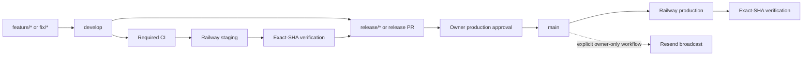

# Production and release runbook

This is the executable launch path for Aflora's platform. Article selection,
writing, and lesson construction are intentionally outside this runbook.

## Current state

As of 2026-07-24, Railway staging and production both pass the repository's
platform smoke test. Production has isolated PostgreSQL, web, and newsletter API
services connected to `main`; `https://aflora.page` is healthy and canonical,
and public double-opt-in signup is enabled. The API is healthy at
`https://api.aflora.page` with production-only database and Resend credentials,
the isolated `aflora-production` segment, explicit CORS, public audience policy,
and a unique event salt. Its enabled Resend webhook also uses the custom API
domain. `news.aflora.page` is verified in Resend and production uses the
authenticated sender. Both application services in staging and production
consume their committed `railway.json` files. No staging database, credential,
segment, or subscriber was copied.

## Architecture and safety boundary



Merging or deploying never sends email. Broadcast creation, sending, and
scheduling are separate owner-only manual actions with issue-state, allowlist,
and exact-confirmation gates.

## 1. Provision production

Create production from scratch; do not duplicate staging, because subscriber
data, PostgreSQL credentials, Resend segments, webhook secrets, and event salts
must not be shared.

1. Add a production PostgreSQL service with a persistent volume. Configure
   backups according to [`database-recovery.md`](database-recovery.md).
2. Add `grove-newsletter-api`, connect it to `luccae11235/grove` on `main`, and
   select `/apps/newsletter-api/railway.json`.
3. Add `grove-web`, connect it to the same repository and branch, and select
   `/apps/web/railway.json`.
4. Generate Railway domains for both application services.
5. Configure the API variables and the web variables listed in `.env.example`.
   Before public launch, omit `PUBLIC_NEWSLETTER_API_URL` from the production web
   build so the form stays disabled; use a production-only API recipient
   allowlist and keep `NEWSLETTER_PUBLIC_SIGNUP=false`.
6. Use a production-only Resend segment and webhook. Never point production at
   the staging segment.
7. Deploy and verify the web service with `SHOW_DRAFTS=false`. Keep the API
   unavailable until every production-only provider variable is present; then
   deploy it and verify `/health` before exposing signup.

Provisioning is done only when service status is successful, `/health` reaches
production PostgreSQL, production URLs contain no staging data, and a failed web
deployment can be rolled back to its immediately previous successful deployment.

Run the public proof without creating a subscriber or sending mail:

```bash
pnpm operations:smoke \
  --web-url https://<production-web>.up.railway.app \
  --api-url https://<production-api>.up.railway.app \
  --expect-signup-form disabled \
  --expect-audience restricted \
  --expect-release-sha <full-main-commit-sha>
```

`Deployment verification` runs the same proof after successful Railway staging
and production deployment events. It waits for both services to report the
event's exact commit through the web `/version.json` endpoint and API `/health`
response before checking the site, sitemap, CORS, form visibility, and API
audience policy. It can also be dispatched manually with an environment and
full expected commit SHA.

In Railway, the repository owner must enable **Wait for CI** for both application
services in both environments. This provider-side setting cannot be expressed in
`railway.json`. Without it, Railway may begin deploying a branch commit before
GitHub quality checks finish. Both committed Railway configurations intentionally
deploy on every selected-branch commit so web and API share one release SHA.

Bootstrap note: GitHub only activates a new `deployment_status` workflow after
the workflow exists on the default branch. For the first staging deployment of
this hardening change, run the documented smoke command locally against staging
with the full `develop` SHA and attach its JSON output to the release PR. After
the workflow reaches `main`, later staging and production deployments are
verified automatically.

## 2. Use the lightweight GitFlow

Normal changes follow this path:

1. branch `feature/<name>` or `fix/<name>` from `develop`;
2. open a pull request into `develop` and require all quality checks;
3. review the result in Railway staging;
4. open `release/<version>` when a stabilization branch is useful, otherwise
   open a `develop` → `main` release pull request;
5. allow only release fixes on `release/*`, record explicit production approval
   with the `production-approved` label, then merge into `main`;
6. wait for `Deployment verification` to prove the exact production commit;
7. tag the verified commit; and
8. merge any release-only fixes back into `develop`.

After staging review, the manual `Prepare weekly release` GitHub workflow opens
the `develop` → `main` pull request with the release checklist. It refuses an
empty release or a duplicate open release pull request. This removes routine PR
setup without weakening the review boundary.

Urgent production fixes use `hotfix/<name>` from `main`, merge into `main`, pass
the production proof, and then merge back into `develop`.

The `Pull request policy` workflow requires normal PRs into `develop` to use an
approved branch prefix and close an open issue. For `main`, it accepts only
`develop`, `release/*`, or `hotfix/*` and requires the owner-applied
`production-approved` label. These checks are evidence, not enforcement against
direct pushes. The owner has accepted this limitation for the private,
owner-managed project rather than paying for technical branch protection.
Direct pushes to `develop` and `main` remain prohibited by the documented
release process.

## 3. Ownership and automation map

Repository automation prepares evidence; it never grants its own production
approval and never sends a newsletter.

| Action | Repository automation or maintainer can do | Repository owner must do |
| --- | --- | --- |
| Create issue, branch, implementation PR, tests, and preview artifact | Yes | Review the proposed scope |
| Run typecheck, tests, production build, and newsletter preview | Yes | Resolve or explicitly reject failures |
| Deploy selected branches after CI | Railway can automate it | Enable **Wait for CI** on all four application service/environment combinations |
| Verify staging and production endpoints against an exact SHA | `Deployment verification` | Review the staging result before production approval |
| Approve a release PR | No | Apply `production-approved` only after the release checklist is complete |
| Merge to `main` | No | Merge in a deliberate release window |
| Prove rollback | Automation can verify the result | Authorize and execute the coordinated Railway rollback drill |
| Validate newsletter artifacts on `main` | Workflow can build and validate | Manually dispatch the owner-only workflow |
| Create a provider draft, send, or schedule | No automatic trigger exists | Dispatch deliberately; real send/schedule requires `SEND:<issue-id>` |
| Change DNS, GitHub plan, backups, alerts, cost limits, or provider settings | Documentation can specify and verify observable results | Change the provider/account configuration |
| Enable public signup | No | Complete every launch gate, remove the allowlist, change both launch variables, and approve the deployment |

## 4. Prove rollback before launch

Rollback is a coordinated production operation because web and API must continue
to report one release SHA.

1. Record the current production commit, both successful Railway deployment IDs,
   the database migration level, and a passing deployment verification run.
2. Confirm that the target revision is compatible with the current database.
   If it is not, stop and prepare a forward fix; never reverse an incompatible
   production migration casually.
3. In a release window, roll both application services back to deployments from
   the same previous commit. Do not change PostgreSQL data or newsletter
   delivery settings.
4. Wait for both health checks and run `Deployment verification` manually with
   the previous full commit SHA.
5. Redeploy the approved current commit to both services and require the
   exact-SHA verification to pass again.
6. Record deployment IDs, timestamps, verification-run links, operator, and any
   unexpected behavior in the release PR.

The first drill must keep public signup disabled and must not create a subscriber,
provider draft, or broadcast.

## 5. Prove the newsletter before opening it

Use staging and only controlled test addresses to prove signup, confirmation,
invalid and repeated tokens, unsubscribe, bounce, complaint, signed webhook
handling, and issue reporting. Do not use the production audience for these
tests.

For production delivery on the current private GitHub Free repository,
configure these as repository-level Actions variables and secrets:

- variables: `WEB_URL`, `API_PUBLIC_URL`, `PUBLIC_PRIVACY_CONTACT_EMAIL`,
  `NEWSLETTER_FROM`, `NEWSLETTER_REPLY_TO`, and `NEWSLETTER_PUBLIC_SIGNUP`;
- secrets: `DATABASE_URL`, `RESEND_API_KEY`, `RESEND_WEBHOOK_SECRET`,
  `RESEND_SEGMENT_ID`, optional `RESEND_TOPIC_ID`, `EVENT_HASH_SALT`, postal
  address, and the pre-launch `NEWSLETTER_RECIPIENT_ALLOWLIST`.

Then use `Controlled newsletter delivery` in this order:

1. `validate` builds and validates artifacts without calling Resend;
2. `draft` creates one provider draft for review;
3. `send` or `schedule` requires `SEND:<issue-id>` and an owner-only manual
   dispatch; and
4. `newsletter:report` confirms delivery events afterward.

Opening the newsletter meant removing the API allowlist, setting
`NEWSLETTER_PUBLIC_SIGNUP=true`, adding `PUBLIC_NEWSLETTER_API_URL` to the web
build, rebuilding with signup enabled, and
performing the internal send checks in `newsletter-operations.md`. This launch
completed on 2026-07-24. Ordinary deployments must preserve the public form and
public audience policy unless an incident requires signup to be paused.

## 6. Definition of launch-ready

Aflora is ready for everyone only when all of these are evidenced:

- production web, API, and PostgreSQL are isolated, healthy, backed up, and
  recoverable;
- a reviewed change has traveled from feature branch through staging and `main`
  to a successful production smoke test;
- the custom domain, HTTPS, SPF, DKIM, and DMARC are verified;
- staging has proven consent, suppression, webhooks, and reporting end to end;
- a production internal send renders correctly in Gmail, a second provider,
  mobile, and plain text;
- the postal, privacy, reply-to, abuse, recovery, and incident contacts are real
  and monitored; and
- alerts, cost limits, ownership, and a tested PostgreSQL restore exist before
  public subscriber data is collected.

Until every item passes, keep the public launch switch closed.
